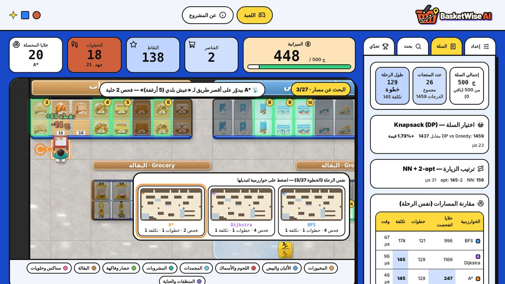
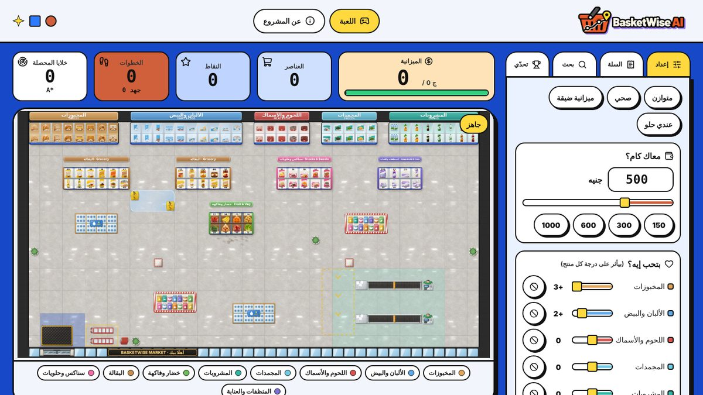
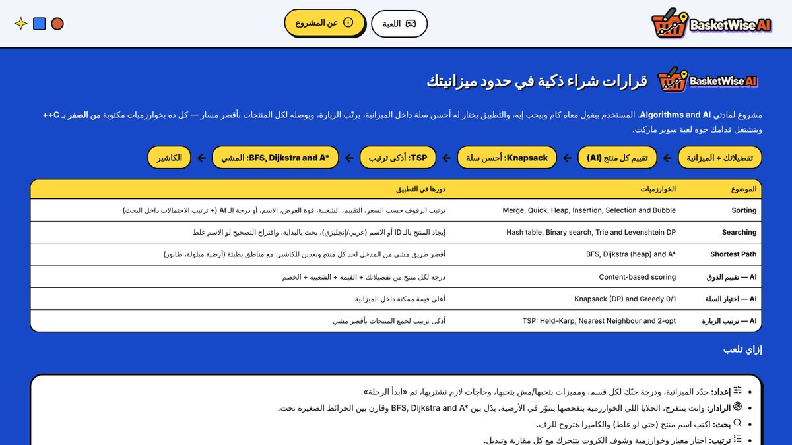
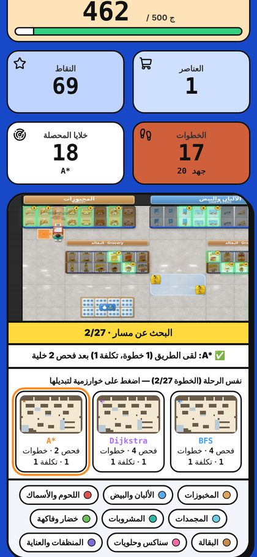

# BasketWise AI

A smart-shopping simulator built for the Algorithms and AI course. You give it a budget and your preferences, and it decides what to buy, in which order to visit the shelves, and which path to walk through the store. The algorithms run in a C++ backend. The web interface shows each decision on a 2D map of a supermarket.

Live demo: https://basket-wise-ai.vercel.app



## Team

East Port Said National University, Faculty of Computer Science and Information Technology.

| Name |
|---|
| Amr Walid Bakheet |
| Mohamed Mahmoud Shadad |
| Mohamed Mostafa Zaki |
| Ziad Wagih El Sharkawy |
| Hazem Gad Amin Marai |
| Ahmed Ibrahim Ramadan Hafez |
| Hossam Nasser Othman |
| Ahmed Ibrahim Ragab |
| Mohamed Nagi Abdel Aal |
| Omar Alaa Eldin Shaker |

Supervised by Dr. Sara Abo Hasish and Dr. Aya Elsayed, with teaching assistants Tasneem Elattar and Sama Bessar.

## What it does

1. Scores every product against the user's preferences (content-based scoring).
2. Picks the best basket that fits the budget (0/1 knapsack, compared with a greedy version).
3. Orders the shelf visits (travelling salesman: Held-Karp, nearest neighbour and 2-opt).
4. Finds the walking path between stops with BFS, Dijkstra or A*, on a 42 x 22 grid where some cells cost more to cross (wet floor, checkout queue).

The map shows the cells each path algorithm examined, so the difference between the three is visible: BFS minimises steps, Dijkstra and A* minimise cost, and A* examines far fewer cells.

Other parts of the app: product search with spelling correction (Arabic and English), an animated sorting view for six algorithms, and a challenge mode that compares the player's basket with the optimal one.

## Algorithms

All of these are written from scratch in `backend/src`. The backend does not use `std::sort`, `priority_queue`, `map` or `unordered_map`; the heap, hash table, trie, sorts and JSON parser are our own code. The tests use `std::sort` only as a reference to compare against.

| Topic | Algorithms | Used for |
|---|---|---|
| Sorting | Merge, Quick (median of three), Heap, Insertion, Selection, Bubble | Ordering products by price, rating, popularity, discount, name or AI score. Each run records a trace that the interface replays as an animation. |
| Searching | Hash table, Binary search, Trie, Levenshtein distance | Lookup by id, exact name, name prefix, and spelling suggestions. |
| Shortest path | BFS, Dijkstra with a binary heap, A* with Manhattan distance | Walking path from the entrance to each product and then to the checkout. |
| Scoring | Weighted content-based score | Ranks products by preference, value, popularity and discount. |
| Basket | 0/1 knapsack (dynamic programming), greedy, brute force for verification | Highest total score within the budget. |
| Visit order | Held-Karp, nearest neighbour, 2-opt | Order of shelves to visit, using real Dijkstra costs as distances. |

More detail on each one is in [docs/BACKEND.md](docs/BACKEND.md). The HTTP interface is described in [docs/API.md](docs/API.md).

## Running it locally

You need a C++17 compiler (g++), make, and Node.js 18 or newer. On Windows, use WSL.

```bash
npm start
```

This builds the backend if needed, installs the frontend packages on first run, starts the C++ server on port 8080 and the web app on http://localhost:5173.

| Command | Purpose |
|---|---|
| `npm start` | Run backend and frontend together |
| `npm test` | Run the C++ tests |
| `npm run backend` | Run only the backend |
| `npm run data` | Regenerate `data/store.json` |

If the page says it cannot reach the backend, the C++ server is not running. Use `npm start`, or build it with `make -C backend`. If port 8080 is taken, run `API_PORT=8090 npm start`.

## Tests

```bash
npm test
```

39 tests with 37,355 checks. They cover every sorting algorithm against `std::sort` on random, sorted, reversed and duplicate data, the JSON parser, Arabic text normalisation, search and spelling correction, the hash table, trie and Levenshtein code, path correctness (BFS gives the fewest steps, Dijkstra and A* agree), knapsack against brute force, Held-Karp against all permutations, the planner end to end, and the HTTP server over a real socket.

## Project layout

```
backend/    C++17 server and algorithms (src/), tests (tests/), Makefile
frontend/   React and Vite app: src/engine (map and animation), src/ui, src/pages
data/       store.json, the store map and the 84-product catalogue
assets/     product photos, shelf and shopper sprites
tools/      scripts that generate the catalogue and the store map
scripts/    start script
api/        Vercel function that runs the backend binary
docs/       API and backend notes
```

The store has 84 products in 9 categories, with Arabic and English names and prices in Egyptian pounds.

## Deployment

The frontend is a static Vite build. The backend is a statically linked C++ binary, and `api/[...path].js` starts it inside a Vercel function and forwards `/api/*` requests to it. `vercel.json` sets the build command and includes the binary and `data/store.json` in the function.

To rebuild the binary after changing the backend:

```bash
make -C backend build/basketwise-server CXXFLAGS="-O2 -std=c++17 -pthread -static"
cp backend/build/basketwise-server api/bin/
```

## Screenshots

| Setup | About page | Mobile |
|---|---|---|
|  |  |  |
